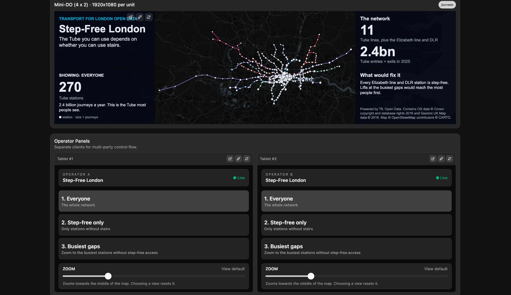

# Step-Free London

A Data Observatory (DO) demo using Transport for London open data. It shows how much of the
Tube you can use if you can't use stairs.



## The story

The wall shows a map of the Tube, Elizabeth line and DLR. A controller switches between three
views:

| View                 | What changes on the wall                                                                                 |
| -------------------- | -------------------------------------------------------------------------------------------------------- |
| **Everyone**         | All 270 Tube stations. Circle size shows how many people use each station.                               |
| **Step-free only**   | Stations with no step-free route from street to platform fade out. 107 stations are left.                |
| **Busiest stations** | The map zooms into central London and the 6 busiest stations without step-free access are coloured pink. |

There is also a zoom slider, as in the original starter.

- **Key message:** most Tube stations can't be used without stairs, including some of the busiest.
- **Audience:** DO visitors (researchers, policymakers, the public).
- **Takeaway:** 163 of 270 Tube stations (60%) have no step-free route, and they handle 1.0
  billion journeys a year (41%). Every Elizabeth line and DLR station is step-free, so it can be
  done.

The numbers are calculated from the data when the page loads, not typed in.

## Run it

You need Node.js 22.12 or newer and pnpm (if `pnpm` is missing, run `corepack enable` once).

```bash
pnpm install
pnpm dev
```

Then open http://localhost:5780.

`pnpm dev` runs `vp run website#dev`. If you have Vite+ installed globally, `vp run dev` does
the same thing.

If nobody uses the controller, the wall moves to the next view every 15 seconds.

## What you see

The real DO is a wall of 16 x 4 screens controlled from tablets. The home page imitates it:

- **Top:** a 4 x 2 mini wall. Each tile is one `/screen?c=<column>&r=<row>` page, the same page
  a DO screen would load. Text is on the outer columns and the map is in the middle.
- **Bottom:** two tablets (`/control`). Use either one and all screens and the other tablet
  update.

The starter used 3 x 2. I used 4 x 2 because it is closer to the shape of the real wall and
leaves two columns for the map.

## How it works

```
data-pipeline/build_network.py  ->  apps/website/public/data/network.json   (run once)

/control  --request-->  /bus (server)  --state-->  every /screen
                        keeps { view, zoom, playing }
```

1. **Data.** A Python script downloads three TfL datasets and writes one JSON file (82 KB). The
   file is committed, so you don't need to run the script.
2. **Controller.** Sends small messages such as `{ type: 'control/view', view: 'stepfree' }`.
   Slider messages are sent at most every 100 ms.
3. **Server.** Checks each message, updates the shared state `{ view, zoom, playing }` and sends
   it to every screen and tablet. It also runs the 15-second autoplay timer. A screen that
   reconnects gets the current state straight away.
4. **Screens.** Each screen gets the state and works out the rest:
    - which stations and lines to fade (`lookFor` in `lib/story/map.ts`)
    - where the camera should be (`cameraFor`), shifted for its own position on the wall
      (`screenView`) so the 8 maps line up
    - its part of the text, which is drawn once for the whole wall and shifted the same way

On a standalone screen the map is drawn with deck.gl, as the starter recommends. Inside the
simulator's iframes it uses MapLibre layers instead, because 8 deck.gl canvases can run out of
WebGL contexts. Both use the same `lookFor` values.

### Main files

| File                                           | What it does                        |
| ---------------------------------------------- | ----------------------------------- |
| `apps/website/src/lib/story/views.ts`          | The three views and their text      |
| `apps/website/src/lib/story/analysis.ts`       | The numbers shown on the wall       |
| `apps/website/src/lib/story/map.ts`            | Map layers, fading, camera          |
| `apps/website/src/routes/screen.tsx`           | One wall screen                     |
| `apps/website/src/components/deck-map.tsx`     | deck.gl drawing                     |
| `apps/website/src/components/wall-overlay.tsx` | Text on the wall                    |
| `apps/website/src/routes/control.tsx`          | The tablet                          |
| `apps/website/src/routes/bus.ts`               | The server                          |
| `apps/website/src/lib/wall.ts`                 | Wall size                           |
| `data-pipeline/build_network.py`               | Downloads and prepares the TfL data |

## DO guidelines

Following the DO toolkit:

- key message, audience and takeaway written first
- the map is the focus in the middle; text sits on the outer screens
- text is at least 3% of the wall height; Arial; dark background
- no text crosses a screen edge
- slow fades, nothing flashing

## Running on the real DO (16 x 4)

```bash
VITE_WALL_COLS=16 VITE_WALL_ROWS=4 pnpm dev
```

Open `/screen?c=<0-15>&r=<0-3>` on each DO screen and `/control` on the tablets.

## Data

Powered by TfL Open Data. Contains OS data © Crown copyright and database rights 2016 and
Geomni UK Map data © and database rights 2019. Map © OpenStreetMap contributors © CARTO.

| Data                       | Source                                                  | Used for                       |
| -------------------------- | ------------------------------------------------------- | ------------------------------ |
| Line routes                | TfL Unified API `/Line/{id}/Route/Sequence/{direction}` | Station order and track shapes |
| Station step-free data     | TfL `stationdata/tfl-stationdata-detailed.zip`          | Which stations are step-free   |
| Annual Station Counts 2025 | `crowding.data.tfl.gov.uk`                              | Journeys per station           |

**How "step-free" is worked out.** TfL's station data lists the lifts, ramps and level
walkways inside each station (no stairs or escalators). The script starts at each station's
street entrance and follows only those. If it can reach a line's platforms, that line counts as
step-free at that station.

To rebuild the data (Python 3.10+, no extra packages):

```bash
python3 data-pipeline/build_network.py
```

**Limitations.**

- "Step-free" means street to platform. It doesn't include the gap between platform and train,
  or lifts that are out of order.
- TfL counts Bank and Monument together, so their combined total is shown at Bank.
- Overground lines are not included.

## Checks

```bash
pnpm ready
```

Runs formatting, linting, a few tests (`apps/website/src/lib/checks.test.ts`) and a build.

Based on [dsi-icl/do-starter-playground](https://github.com/dsi-icl/do-starter-playground). See
[BEST_PRACTICES.md](BEST_PRACTICES.md).
